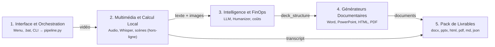

# Video to PowerPoint & More

Ce projet convertit un enregistrement video (reunion, formation, atelier ou conference) en documents de travail complets:

- Transcription integrale horodatee, calculee en local avec Whisper.
- Synthese factuelle des constats et decisions.
- Note de cadrage Word (.docx) illustree par les captures de la video.
- Diaporama PowerPoint 16:9 (.pptx).
- Version web autonome (.html) et export imprimable (.pdf).

> **Note d'avancement :** Le pipeline automatise, les scripts d'export, le module d'installation Windows et les integrations systeme sont operationnels. L'UI reste a mettre en place!

---

## Architecture Technique (Schema Vue d'ensemble)

Le pipeline repose sur 5 couches interconnectees, conformement au schema d'architecture du dossier [`archi/`](./archi/) :

Le schema interactif complet est consultable directement dans [`archi/Vue d'ensemble.html`](./archi/Vue%20d'ensemble.html).

### Les Composants des 5 Couches

1. **Interface et Orchestration** :
   - Point d'entree au clic droit Windows via le menu contextuel, lanceur `LANCER_PIPELINE.bat` et interface d'installation `install_gui.ps1`.
   - Orchestrateur PowerShell `run_pipeline.ps1` assurant l'initialisation du runtime et la gestion des reprises.
   - Script `pipeline.py` pilotant l'enchainement des operations.

2. **Multimedia et Calcul Local (100% hors-ligne)** :
   - Extraction audio: separation du signal WAV mono a 16 000 Hz (`pcm_s16le`) via le binaire autonome `ffmpeg` (embarque par `imageio-ffmpeg`).
   - Transcription Whisper: inference vocale locale par `faster-whisper` adossee a CTranslate2 en quantification int8 CPU ou CUDA float16. Progression en temps reel `tqdm` et ecriture continue sur disque dans `transcript.md`.
   - Detection des scenes: analyse des flux visuels par `PySceneDetect` (`ContentDetector`) pour extraire 18 a 40 images cles stables en resolution 1080p.

3. **Intelligence et FinOps** :
   - Synthese LLM: envoi de la transcription vers les modeles de grande fenetre de contexte (OpenAI `gpt-4o-mini`, Google Gemini `gemini-2.0-flash` ou Mistral `mistral-large-latest`).
   - Regles Humanizer: elimination systematique des tics d'ecriture d'IA, des accroches theatrales et des metaphores abstraites. Structuration d'enseignements cles, puces denses et notes d'orateur.
   - Bilan FinOps: fonction `calculate_finops_cost` mesurant les jetons exacts et valorisant les couts d'API ainsi que les economies realisees en local.

4. **Generateurs Documentaires** :
   - Generateur Word: production de la note de cadrage et du mode d'emploi via `python-docx` avec encadres methodologiques et captures centrees.
   - Generateur PowerPoint: creation de diaporamas 16:9 widescreen via `python-pptx`, incluant l'enseignement cle, cartes KPI et notes d'orateur natives.
   - Generateur Web: compilation du deck interactif autonome en HTML5 et CSS3 Grid avec visuels embarques en Base64.
   - Moteur PDF: conversion vectorielle 16:9 sans debordement de page via Chromium headless.

5. **Pack de Livrables** :
   - Centralisation des 7 livrables directement exploitables (`.docx`, `.pptx`, `.html`, `.pdf`, `.md`, `.json`, `keyframes/`) dans le sous-dossier de destination.

---

## Installation sous Windows

L'assistant configure l'environnement sans installation prealable de Python ou de Git:

1. Telechargement du depot:
   Recuperez l'archive via le lien: [video-2-powerpoint-and-more.zip](https://github.com/caroheymes/video-2-powerpoint-and-more/archive/refs/heads/master.zip).
2. Decompression de l'archive:
   Faites un clic droit sur le fichier zip et choisissez "Extraire tout".
3. Execution de l'installeur:
   Dans le dossier dezippe, double-cliquez sur `INSTALLER_WINDOWS.bat`.

Dans la fenetre de configuration:
- Choisissez le fournisseur d'IA (OpenAI, Google Gemini ou Mistral).
- Renseignez votre cle d'API.
- Cliquez sur "Installer & Configurer".

L'assistant cree les raccourcis systeme:
- Une icone "Video to PowerPoint" sur le Bureau.
- Une action "Convertir avec Video2PowerPoint (IA)" dans le menu contextuel Windows des fichiers video.

---

## Utilisation au Quotidien

Deux modes d'execution sont disponibles:

### 1. Par le menu contextuel (clic droit)
Sur tout fichier video (.mp4):
- Sous Windows 11: faites un clic droit, selectionnez "Afficher d'autres options" (ou utilisez le raccourci `Maj + F10`), puis cliquez sur "Convertir avec Video2PowerPoint (IA)".
- Sous Windows 10: faites un clic droit puis cliquez directement sur "Convertir avec Video2PowerPoint (IA)".

### 2. Par le lanceur ou l'icone Bureau
Double-cliquez sur `LANCER_PIPELINE.bat` (ou le raccourci Bureau):
- Touche Entree: telecharge et traite la video de demonstration (7 minutes).
- Option 2: ouvre l'explorateur pour selectionner un fichier video local.
- Option 3: permet de renseigner un lien Google Drive.
- Le glisser-deposer d'un fichier video dans la fenetre de console est egalement pris en charge.

### Suivi d'execution et volumetrie adaptative
- Progression console: la transcription Whisper affiche une barre dynamique indiquant le temps ecoule, le pourcentage et l'estimation de fin.
- Ecriture continue: le fichier `transcript.md` est cree des le lancement et alimente au fur et a mesure du decodage audio.
- Diaporama calibre selon la duree: le nombre de diapositives s'adapte automatiquement (10 pour moins de 10 minutes, 18 pour 30 minutes, 25 a 35 pour les enregistrements superieurs a une heure). L'argument `--slides` permet de forcer une valeur fixe.

### Emplacement des livrables
- Pour une video locale: les fichiers sont crees dans un dossier `<NomDeLaVideo>_livrables` place a cote de la video source.
- Pour la video d'essai: les fichiers sont stockes dans `demo/output/`.
- En fin de traitement, l'explorateur s'ouvre sur le dossier des livrables avec une notification de confirmation.

---

## Resultats sur la Video de Demonstration

Le pipeline a ete verifie sur un enregistrement de 7 minutes (intervention de Zoe Hames sur l'ouvrage Too Fast to Think):
- Source: [Lien Google Drive](https://drive.google.com/file/d/1pbT3kRivzOONa3B1bRP1nIhbFdkt3ef2/view?usp=sharing)
- Temps de traitement: 1 minute 11 secondes sur configuration de bureau standard.

Livrables disponibles dans [`demo/output/`](./demo/output/):

| Document | Fichier genere | Contenu |
| :--- | :--- | :--- |
| Note de cadrage | [`article_mode_d_emploi.docx`](./demo/output/article_mode_d_emploi.docx) | Document Word en 5 sections operationnelles avec captures et constats. |
| Diaporama PowerPoint | [`presentation.pptx`](./demo/output/presentation.pptx) | Presentation 16:9 de 10 diapositives sans verbiage d'IA. |
| Version imprimable | [`presentation.pdf`](./demo/output/presentation.pdf) | Rendu PDF paysage page a page. |
| Presentation web | [`presentation.html`](./demo/output/presentation.html) | Fichier web autonome lisible hors-ligne avec navigation clavier. |
| Synthese executive | [`summary.md`](./demo/output/summary.md) | Synthese factuelle des constats et decisions. |
| Bilan FinOps | [`finops_report.json`](./demo/output/finops_report.json) | Rapport comptable des jetons, des couts d'API et des gains du calcul local. |
| Transcription brute | [`transcript.md`](./demo/output/transcript.md) | Retranscription integrale horodatee via Whisper. |
| Captures video | [`keyframes/`](./demo/output/keyframes/) | 18 images des plans stables de la video. |

---

## Evaluation FinOps et Maîtrise des Depenses

L'architecture reduit les couts d'infrastructure et d'API:

- Traitement lourd en local (0,00 €): l'extraction audio (`ffmpeg`), la transcription (`faster-whisper`), la detection des scenes (`scenedetect`) et la generation des documents (Word, PowerPoint, HTML, PDF) s'executent sur la machine de l'utilisateur sans service tiers.
- Gain de calcul local constate: l'inference locale Whisper evite la facturation des services cloud audio (base standard de 0.006 $ par minute, soit 0.42 $ de gain direct par heure traitee).
- Depenses LLM mesurees: seule la structuration editoriale sollicite l'API externe (OpenAI `gpt-4o-mini`, Google Gemini ou Mistral), avec un cout inferieur a 0.002 € pour 10 minutes et moins de 0.05 € pour une reunion d'une heure.
- Tracabilite financiere: un fichier `finops_report.json` consigne a chaque run le decompte des jetons et la valorisation en devises (dollars et euros).

---

## Organisation du Depot

- `INSTALLER_WINDOWS.bat`: assistant d'installation pour Windows (racine).
- `LANCER_PIPELINE.bat`: lanceur principal du pipeline (racine).
- `LANCER_TESTS.bat`: banc de test automatise de 23 tests (racine).
- `archi/`: schema interactif d'architecture et description des flux (`Vue d'ensemble.html`).
- `demo/`: code source, dependances virtuelles, tests et sorties.
- `scripts_historiques/`: scripts d'exploration initiaux.

---

## Documents de Reference et Specifications

L'ensemble des documents de cadrage du projet est directement accessible:

- [`demo/prd.md`](./demo/prd.md) : Cahier des charges et specifications fonctionnelles completes (PRD).
- [`demo/brief.md`](./demo/brief.md) : Brief initial du projet.
- [`demo/addendum.md`](./demo/addendum.md) : Decisions d'architecture technique et matrice de dimensionnement.
- [`archi/Vue d'ensemble.html`](./archi/Vue%20d'ensemble.html) : Schema interactif des 5 couches d'architecture et de leurs flux.

---

## Validation et Tests Automatises

Une suite de 23 tests automatises `pytest` verifie chaque composant:
- Environnement: disponibilite du binaire `ffmpeg` et import des modules (`faster-whisper`, `scenedetect`, `python-docx`, `python-pptx`, `Pillow`).
- Formats documentaires: validation de la structure Word (`.docx`), du format 16:9 PowerPoint (`.pptx`), du fichier HTML autonome et de l'export PDF.
- Integration continue (Harness E2E): validation de l'enchainement complet et generation conjointe des 7 livrables.
- Cadrage editorial: controle des filtres anti-cliches et de l'epuration lexicale.
- Module FinOps: validation des calculs de couts d'API et des economies Whisper.

Pour executer la suite de tests:
Double-cliquez sur `LANCER_TESTS.bat` ou lancez `.\.venv\Scripts\python.exe -m pytest tests -s -v` depuis `demo/`.
