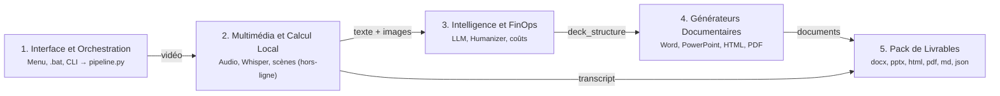

# Moteur de Traitement Video et Generation de Decks Multi-Formats (demo/)

Ce dossier contient la chaine de traitement pour convertir un enregistrement video (reunion, formation, atelier ou conference) en 7 livrables documentaires et visuels.

> **Note d'avancement :** Le pipeline automatise, les scripts d'export, le module d'installation Windows et les integrations systeme sont operationnels. L'UI reste a mettre en place!

---

## Les 7 Livrables Generes

Chaque execution produit un ensemble de documents dans le repertoire cible (un sous-dossier `<NomDeLaVideo>_livrables` cree a cote du fichier video source, ou dans [`demo/output/`](./output/) pour la video d'essai):

| Livrable | Fichier genere | Format | Role et contenu |
| :--- | :--- | :---: | :--- |
| Note de cadrage | [`article_mode_d_emploi.docx`](./output/article_mode_d_emploi.docx) | `.docx` | Document Word structure en 5 a 10 sections operationnelles. Reunit constats chiffres, recommandations, encadres methodologiques et captures extraites de la video. |
| Diaporama PowerPoint | [`presentation.pptx`](./output/presentation.pptx) | `.pptx` | Support PowerPoint au format large 16:9 widescreen, structure avec typographies Segoe UI et Calibri, puces courtes, indicateurs chifPoint et captures synchronisees. |
| Support web interactif | [`presentation.html`](./output/presentation.html) | `.html` | Presentation plein ecran autonome sans dependance externe, navigable au clavier (fleches, espace) et lisible hors-ligne avec images integrees en base64. |
| Export imprimable 16:9 | [`presentation.pdf`](./output/presentation.pdf) | `.pdf` | Rendu vectoriel paysage page par page, sans coupure de diapositive, genere par le moteur Chromium headless. |
| Synthese executive | [`summary.md`](./output/summary.md) | `.md` | Synthese textuelle des constats essentiels, arbitrages et decisions, completee par le bilan FinOps. |
| Bilan FinOps | [`finops_report.json`](./output/finops_report.json) | `.json` | Rapport comptable detaillant les jetons consommes, les couts d'API factures en dollars et en euros, et les economies realisees via l'inference locale. |
| Transcription integrale | [`transcript.md`](./output/transcript.md) | `.md` | Transcription textuelle exhaustive horodatee seconde par seconde avec identification de la langue et de la duree. |
| Captures cles (keyframes) | [`keyframes/`](./output/keyframes/) | `.jpg` | Selection de 18 a 40 diapositives et moments stables extraits en resolution 1080p. |

---

## Architecture Technique (Schema Vue d'ensemble)

Le pipeline repose sur 5 couches interconnectees, conformement au schema d'architecture du dossier [`archi/`](../archi/) :



Le schema interactif complet est consultable directement dans [`archi/Vue d'ensemble.html`](../archi/Vue%20d'ensemble.html).

### Les Composants des 5 Couches

1. **Interface et Orchestration** :
   - Point d'entree au clic droit Windows via le menu contextuel, lanceur `LANCER_PIPELINE.bat` et interface d'installation `install_gui.ps1`.
   - Orchestrateur PowerShell `run_pipeline.ps1` assurant l'initialisation du runtime et la gestion des reprises.
   - Script `pipeline.py` pilotant l'enchainement des operations.

2. **Multimedia et Calcul Local (100% hors-ligne)** :
   - Extraction audio: separation du signal WAV mono a 16 000 Hz (`pcm_s16le`) via le binaire autonome `ffmpeg` (embarque par `imageio-ffmpeg`).
   - Transcription Whisper: inference vocale locale par `faster-whisper` adossee a CTranslate2 en quantification int8 CPU ou CUDA float16. Progression en temps reel `tqdm` et ecriture continue sur disque dans `transcript.md`.
   - Detection des scenes: analyse des flux visuels par `PySceneDetect` (`ContentDetector`) pour extraire 18 a 40 images cles stables en resolution 1080p.

3. **Intelligence et FinOps** :
   - Synthese LLM: envoi de la transcription vers les modeles de grande fenetre de contexte (OpenAI `gpt-4o-mini`, Google Gemini `gemini-2.0-flash` ou Mistral `mistral-large-latest`).
   - Regles Humanizer: elimination systematique des tics d'ecriture d'IA, des accroches theatrales et des metaphores abstraites. Structuration d'enseignements cles, puces denses et notes d'orateur.
   - Bilan FinOps: fonction `calculate_finops_cost` mesurant les jetons exacts et valorisant les couts d'API ainsi que les economies realisees en local.

4. **Generateurs Documentaires** :
   - Generateur Word: production de la note de cadrage et du mode d'emploi via `python-docx` avec encadres methodologiques et captures centrees.
   - Generateur PowerPoint: creation de diaporamas 16:9 widescreen via `python-pptx`, incluant l'enseignement cle, cartes KPI et notes d'orateur natives.
   - Generateur Web: compilation du deck interactif autonome en HTML5 et CSS3 Grid avec visuels embarques en Base64.
   - Moteur PDF: conversion vectorielle 16:9 sans debordement de page via Chromium headless.

5. **Pack de Livrables** :
   - Centralisation des 7 livrables directement exploitables (`.docx`, `.pptx`, `.html`, `.pdf`, `.md`, `.json`, `keyframes/`) dans le sous-dossier de destination.

---

## Evaluation FinOps et Suivi des Depenses

La fonction `calculate_finops_cost` detaille la consommation de chaque traitement:

1. Mesure des couts d'API au jeton:
   - Decompte des jetons d'entree et de sortie.
   - Application des grilles officielles par million de jetons.
   - Conversion en dollars et en euros (taux de change retenu: 0.92 € / $).

2. Evaluation des gains lies au calcul local:
   - Comparaison avec le tarif standard des services cloud de transcription audio (0.006 $ par minute).
   - Sur un atelier de 7 minutes: gain de 0.042 $.
   - Sur une reunion de 1 heure 10 minutes: gain de 0.42 $.

3. Couts d'API constates:
   - Une execution courte de 7 a 10 minutes engendre environ 0.0015 € de requete LLM.
   - Une reunion d'une heure reste sous le seuil de 0.05 € d'API.
   - Le detail comptable est consigne dans [`output/finops_report.json`](./output/finops_report.json).

---

## Guide d'Utilisation

### Methode Windows en interface graphique

1. Installation:
   Double-cliquez sur `INSTALLER_WINDOWS.bat`. Selectionnez votre fournisseur d'IA, renseignez votre cle d'acces puis cliquez sur "Installer & Configurer".

2. Conversion via le menu contextuel:
   Sur un fichier `.mp4`:
   - Sous Windows 11: clic droit sur la video, selectionnez "Afficher d'autres options" (ou utilisez le raccourci `Maj + F10`), puis cliquez sur "Convertir avec Video2PowerPoint (IA)".
   - Sous Windows 10: clic droit sur la video puis cliquez sur "Convertir avec Video2PowerPoint (IA)".

3. Conversion via le lanceur:
   Double-cliquez sur `LANCER_PIPELINE.bat` (ou sur le raccourci du Bureau):
   - Appuyez sur Entree pour traiter la video de test integree (7 minutes).
   - Tapez 2 pour selectionner un fichier video sur votre disque via l'explorateur.
   - Tapez 3 pour indiquer une URL Google Drive.

A l'issue de l'operation, le repertoire contenant les 7 livrables s'ouvre avec un message de confirmation.

---

### Methode Ligne de Commande (CLI)

Le moteur s'execute via PowerShell ou directement avec l'interpreteur Python:

```powershell
# 1. Execution via l'orchestrateur PowerShell
.\run_pipeline.ps1 -VideoPath "C:\Videos\session.mp4" -Provider openai -ModelSize medium

# 2. Execution via l'interpreteur Python
.\.venv\Scripts\python.exe pipeline.py --video "C:\Videos\session.mp4" --output "C:\Livrables" --provider openai --slides 20

# 3. Traitement d'un lien Google Drive
.\.venv\Scripts\python.exe pipeline.py --video "https://drive.google.com/file/d/1pbT3kRivzOONa3B1bRP1nIhbFdkt3ef2/view?usp=sharing" --provider gemini

# 4. Regeneration documentaire a partir d'une transcription existante
.\.venv\Scripts\python.exe pipeline.py --video "C:\Videos\session.mp4" --skip-transcription
```

### Parametres du script `pipeline.py`

| Parametre | Type | Valeur par defaut | Description |
| :--- | :---: | :---: | :--- |
| `--video` | `str` | Requis | Chemin local vers le fichier `.mp4` ou URL Google Drive. |
| `--output` | `str` | `output` | Dossier de destination des livrables. |
| `--model` | `str` | `medium` | Taille du modele Whisper (`tiny`, `base`, `small`, `medium`, `large-v3-turbo`). |
| `--provider` | `str` | `gemini` | Fournisseur de synthese (`openai`, `gemini`, `mistral`). |
| `--api-key` | `str` | Variable d'environnement | Cle d'API pour le fournisseur selectionne. |
| `--slides` | `int` | `0` (automatique) | Nombre cible de diapositives (0 pour calcul automatique selon la duree). |
| `--skip-transcription` | `flag` | `False` | Reutilise le fichier `transcript.md` existant sans relancer l'inference vocale. |

---

## Banc d'Essai et Tests Automatises (`tests/`)

Une suite de 23 tests automatises validee par `pytest` verifie le bon fonctionnement du moteur:

- `test_environment_sanity.py` (2 tests): controle la presence du binaire `ffmpeg` et l'import des bibliotheques obligatoires (`faster-whisper`, `scenedetect`, `docx`, `pptx`, `PIL`).
- `test_units.py` (16 tests): valide les horodatages, l'extraction des identifiants Google Drive, les filtres lexicaux anti-cliches et les formules FinOps pour OpenAI, Gemini et Whisper.
- `test_generators.py` (4 tests): valide la structure du document Word, du fichier PowerPoint 16:9, du deck HTML et de la conversion PDF.
- `test_pipeline_e2e.py` (1 test): test d'integration global verifiant la production conjointe des 7 livrables.

Pour executer la suite de tests:
```cmd
LANCER_TESTS.bat
```
Ou via la commande:
```powershell
.\.venv\Scripts\python.exe -m pytest tests -s -v
```

---

## Structure du Repertoire `demo/`

```text
demo/
├── assets/
│   ├── app_icon.ico           # Icone multi-resolution (16x16 a 256x256) pour Windows
│   └── app_icon.png           # Fichier image source du logo
├── output/                    # Repertoire des livrables de la video de demonstration
│   ├── keyframes/             # Captures d'ecran extraites (slide_keyframe_XX.jpg)
│   ├── transcript.md          # Transcription textuelle complete horodatee
│   ├── summary.md             # Synthese executive et section FinOps
│   ├── finops_report.json     # Rapport comptable de l'execution
│   ├── article_mode_d_emploi.docx # Document Word operationnel
│   ├── presentation.pptx      # Diaporama PowerPoint 16:9
│   ├── presentation.html      # Support web interactif plein ecran
│   ├── presentation.pdf       # Export PDF paysage 16:9
│   └── deck_structure.json    # Schema JSON intermediaire de la presentation
├── tests/                     # Suite de tests automatises (23 tests)
│   ├── conftest.py            # Donnees de test et bouchons partages
│   ├── test_environment_sanity.py # Verification de l'environnement d'execution
│   ├── test_units.py          # Tests unitaires: Drive, FinOps, regles de filtrage
│   ├── test_generators.py     # Verification des formats de sortie
│   └── test_pipeline_e2e.py   # Test d'integration de bout en bout
├── pipeline.py                # Moteur d'orchestration (Whisper, Drive, LLM, exports)
├── run_pipeline.ps1           # Wrapper d'execution PowerShell
├── install_gui.ps1            # Assistant graphique d'installation Windows
├── INSTALLER_WINDOWS.bat      # Lanceur d'installation rapide
├── LANCER_PIPELINE.bat        # Lanceur de traitement avec menu de selection
├── LANCER_TESTS.bat           # Lanceur de la suite de tests unitaires
├── pytest.ini                 # Options de configuration de pytest (-s -v)
├── requirements.txt           # Dependances Python figees
├── brief.md                    # Expression du besoin initial du projet
├── prd.md                     # Cahier des charges fonctionnel detaille (PRD)
├── addendum.md                # Note d'arbitrage et d'architecture technique
└── README.md                  # Documentation technique du module
```

---

## Documents de Reference et Specifications

L'ensemble des documents de cadrage du projet est directement accessible dans ce dossier et dans le repertoire racine:

- [`demo/prd.md`](./prd.md) : Cahier des charges et specifications fonctionnelles completes (PRD).
- [`demo/brief.md`](./brief.md) : Brief initial du projet.
- [`demo/addendum.md`](./addendum.md) : Decisions d'architecture technique et matrice de dimensionnement.
- [`archi/Vue d'ensemble.html`](../archi/Vue%20d'ensemble.html) : Schema interactif des 5 couches d'architecture et de leurs flux.
