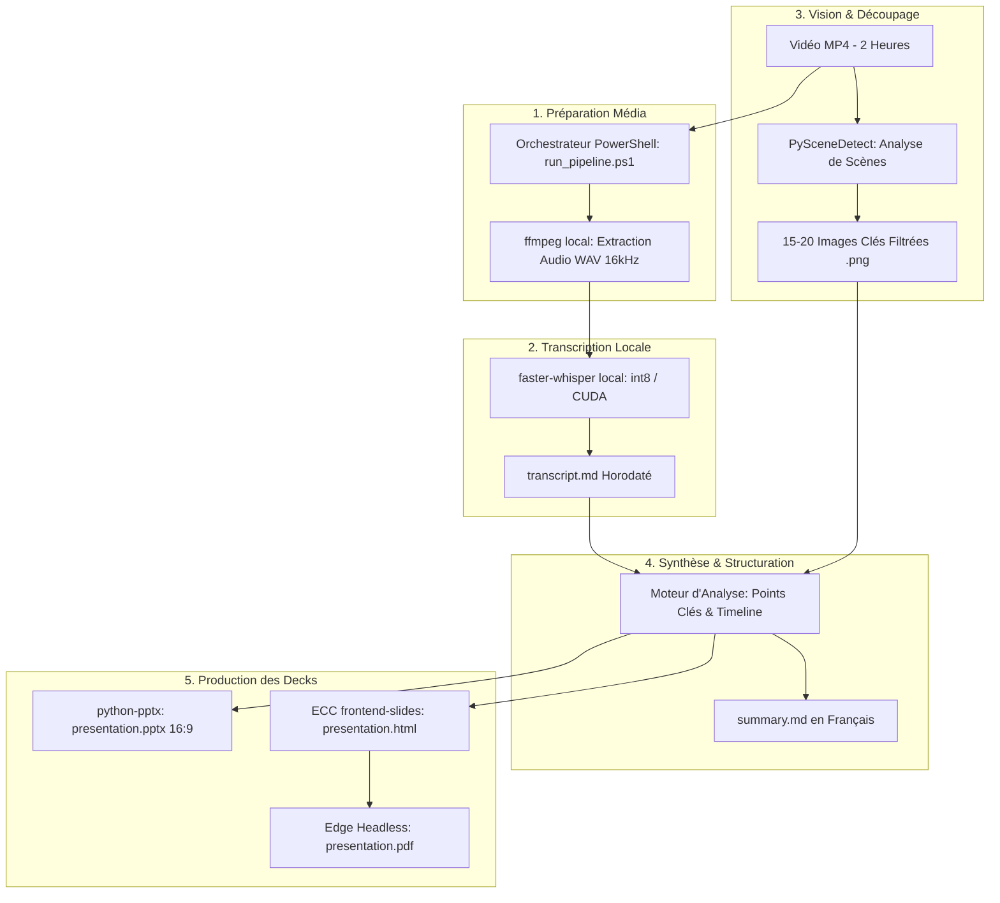

# Product Requirements Document (PRD)
## Pipeline Automatisé : Vidéo Longue (2h) ➔ Transcription, Synthèse & Decks (PPTX + HTML)

---

## 1. Vision du Produit & Contexte

### 1.1 Contexte & Problématique
Dans le cadre de missions de conseil et d'expertises stratégiques auprès de clients exigeants, les enregistrements vidéo de réunions, comités, formations ou conférences d'une durée allant jusqu'à 2 heures représentent une matière brute à très forte valeur ajoutée. 

Cependant, leur exploitation manuelle est chronophage :
- Écoute intégrale et prise de notes fastidieuse.
- Difficulté à isoler les moments clés et les diapositives/écrans pertinents.
- Délai important entre la fin de l'événement et la restitution des livrables (synthèse + support de présentation).
- Contrainte forte de **confidentialité client** interdisant l'envoi de flux vidéo ou audio confidentiels vers des API cloud tierces non sécurisées.

### 1.2 Objectif Produit
Délivrer une solution clé en main, locale et scriptée en **PowerShell**, capable de transformer un fichier vidéo `.mp4` brut de 2 heures en un pack de livrables professionnels en moins de 30 minutes de traitement local :
1. **Un transcript exhaustif horodaté** en Markdown (`transcript.md`).
2. **Une synthèse executive concise en français** en Markdown (`summary.md`).
3. **Un support de présentation PowerPoint natif** (`presentation.pptx`) enrichi des visuels extraits.
4. **Un deck HTML interactif et son export PDF 16:9** (via le standard ECC `frontend-slides`).
5. **Un orchestrateur PowerShell** `run_pipeline.ps1` portable, auto-bootstrappé, avec reprise sur incident (checkpointing).

### 1.3 Métriques de Succès & Contre-Métriques
* **Taux d'automatisation (Success)** : 100% de la chaîne exécutable via une seule commande PowerShell sans intervention humaine intermédiaire.
* **Rapidité de traitement (Success)** : Temps total de traitement < 35 minutes pour 2h de vidéo sur machine de travail type (CPU multi-cœurs ou GPU accéléré).
* **Qualité de transcription (Success)** : WER (Word Error Rate) estimé < 7% sur le français parlé grâce à Whisper Local (modèle `medium` ou `large-v3-turbo`).
* **Zéro fuite de données (Success)** : 100% du traitement audio et vidéo exécuté en local sans appel réseau externe.
* **Contre-Métrique (Counter-Metric)** : Éviter le "Slide Spam" — limitation stricte du nombre de visuels extraits (10 à 25 captures clés maximum) pour préserver la lisibilité du deck sans surcharge visuelle.

---

## 2. Personas & Parcours Utilisateur

### 2.1 Persona Cible
* **Alex, Consultant Senior / Directeur de Projet** :
  * *Besoins* : Livrer rapidement au client un compte-rendu exécutif et un support de soutenance visuel sans passer des heures à retranscrire la vidéo et faire des captures d'écran.
  * *Contraintes* : Respect strict du secret professionnel, environnement Windows standard, absence de configuration manuelle complexe (pas de dépendances système lourdes à installer à la main).

### 2.2 Parcours Utilisateur (User Journey)
1. **Lancement** : Alex dépose son fichier `reunion_client.mp4` dans le dossier projet et lance dans son terminal PowerShell :
   ```powershell
   .\run_pipeline.ps1 -VideoPath ".\reunion_client.mp4"
   ```
2. **Auto-diagnostic & Provisioning** : Le script vérifie la présence de Python/uv et des modules nécessaires (`faster-whisper`, `scenedetect`, `python-pptx`). Si un outil manque, le script l'isole automatiquement dans un environnement virtuel local sans impacter la machine hôte.
3. **Exécution transparente** : Une barre de progression / logs clairs affichent les étapes (Extraction Audio ➔ Transcription ➔ Détection de scènes ➔ Synthèse ➔ Génération des Decks).
4. **Restitution** : Les livrables sont générés dans un sous-dossier horodaté `output/` :
   - `output/transcript.md`
   - `output/summary.md`
   - `output/presentation.pptx`
   - `output/presentation.html` & `output/presentation.pdf`
   - `output/keyframes/` (images sélectionnées)
5. **Livraison Client** : Alex peut directement envoyer le PDF et le PPTX au client ou projeter la version HTML.

---

## 3. Exigences Fonctionnelles (Functional Requirements)

### FR-01 : Gestion des Médias & Prétraitement Audio
* **FR-01.1** : Le système doit accepter en entrée un fichier vidéo au format `.mp4` (ainsi que `.mkv` et `.mov` [ASSUMPTION]).
* **FR-01.2** : Le pipeline doit extraire la piste audio au format WAV 16kHz mono optimisé pour Whisper, sans réencoder inutilement la vidéo.
* **FR-01.3** : L'environnement multimédia (`ffmpeg`/`ffprobe`) doit être auto-résolu (via `static-ffmpeg` ou binaire embarqué local) pour ne pas exiger d'installation administrateur système.

### FR-02 : Transcription Locale Haute Fidélité (Whisper)
* **FR-02.1** : La transcription doit être effectuée 100% en local à l'aide de l'architecture `faster-whisper` (CTranslate2) pour une vitesse 4x supérieure à Whisper vanilla et une consommation mémoire réduite.
* **FR-02.2** : Le système doit détecter automatiquement la présence d'un GPU NVIDIA (CUDA) ; en l'absence de GPU, basculer de manière transparente sur CPU avec quantification `int8`.
* **FR-02.3** : Modèle par défaut : `large-v3-turbo` ou `medium` avec sélection de langue forcée ou auto-détectée sur le français (`fr`).
* **FR-02.4** : Sortie transcript : Génération d'un fichier Markdown `transcript.md` avec horodatages au format `[HH:MM:SS]` et segmentation par blocs d'idées.

### FR-03 : Découpage Intelligent des Scènes & Extraction de Visuels
* **FR-03.1** : Le pipeline doit analyser le flux vidéo pour détecter automatiquement les transitions significatives (changement de slide, transition de plan de caméra, démonstration logicielle) via détection de seuil de contenu (`ContentDetector`).
* **FR-03.2** : Filtrage anti-redondance : Élimination des scènes trop courtes (< 3 secondes) ou des plans quasi-identiques.
* **FR-03.3** : Extraction de keyframes haute résolution (format `.png` ou `.jpg`) capturés au point de stabilité de la scène (milieu du segment).
* **FR-03.4** : Plafond d'extraction : Sélection intelligente d'un échantillon représentatif de 10 à 25 diapositives majeures, horodatées et indexées.

### FR-04 : Synthèse Exécutive & Structuration de Contenu via API LLM (Gemini / Mistral)
* **FR-04.1** : Le système doit exploiter une API LLM souveraine / accessible (Google Gemini ou Mistral AI) via une simple clé d'accès (`GEMINI_API_KEY` ou `MISTRAL_API_KEY`), évitant tout déploiement complexe d'outils locaux comme Ollama pour des utilisateurs non techniques.
* **FR-04.2** : Grâce aux fenêtres de contexte étendues de ces modèles, l'intégralité du transcript de 2 heures (~20 000 à 30 000 mots) est analysée en un seul prompt sans découpage complexe.
* **FR-04.3** : Le moteur doit produire :
  - **Un fichier `summary.md`** : Synthèse exécutive structurée en français (Contexte, Enjeux, Décisions actées, Plan d'action & Recommandations).
  - **Une structure JSON/Markdown des diapositives** : Titres de slides, bullet points percutants, timecodes associés et index de l'image de scène correspondante pour alimenter automatiquement les decks PPTX et HTML.
* **FR-04.4** : Alignement temporel : Les points clés de la synthèse doivent référencer les timecodes `[MM:SS]` et faire le lien avec les captures de scènes correspondantes.

### FR-05 : Génération de Deck PowerPoint Natif (`.pptx`)
* **FR-05.1** : Génération automatisée via `python-pptx` d'un jeu de diapositives au format 16:9 widescreen.
* **FR-05.2** : Structure type du deck (12 à 18 slides) :
  - Slide de titre (Titre de la vidéo, date, durée).
  - Slide Executive Summary (Chiffres clés & enjeux).
  - Slides thématiques combinant : Titre, points clés à puces, et insertion de la capture de scène correspondante.
  - Slide Plan d'action / Roadmap.
  - Slide de conclusion.
* **FR-05.3** : Charte graphique soignée : Police sans-serif moderne, palette de couleurs corporate premium, marge et alignement automatique des images.

### FR-06 : Génération de Deck Web Interactif & Export PDF (ECC `frontend-slides`)
* **FR-06.1** : Génération d'un fichier unique `presentation.html` conforme aux standards ECC `frontend-slides` :
  - Zéro dépendance externe (CSS et JavaScript vanilla embarqués).
  - Responsive et strictement contraint au viewport (`100dvh`, aucun scroll interne intempestif).
  - Transitions fluides, navigation clavier (Flèches, Espace, PageUp/Down) et tactile.
* **FR-06.2** : Mode Standalone Client : Embarquement des captures d'écran en Base64 data URI dans le code HTML pour distribution sans dossier d'assets externe.
* **FR-06.3** : Export automatique en PDF 16:9 (`presentation.pdf`) exploitant le moteur d'impression Edge/Chrome headless (`--headless --print-to-pdf`) avec injection `@media print { size: 16in 9in; }`.

### FR-07 : Rédaction d'un Article & Mode d'Emploi Opérationnel Word (.docx)
* **FR-07.1** : Génération automatisée d'un document Word soigné (`article_mode_d_emploi.docx`) via `python-docx`.
* **FR-07.2** : Structure éditoriale :
  - Cartouche d'en-tête (Titre, sous-titre, contexte, métadonnées).
  - Contexte stratégique & vue d'ensemble des échanges.
  - Démarche pas-à-pas / Mode d'emploi pratique pour les équipes opérationnelles.
  - Encadrés callout de points de vigilance et de bonnes pratiques.
  - Insertion centrée des captures d'écrans clés extraites avec légendes normalisées.
  - Plan d'action et synthèse des décisions.

### FR-08 : Orchestrateur PowerShell (`run_pipeline.ps1`)
* **FR-07.1** : Script PowerShell 7+ / 5.1 compatible, prenant en paramètre le chemin de la vidéo (`-VideoPath`), le niveau de modèle Whisper (`-ModelSize`, défaut `medium`), et le dossier de sortie (`-OutputDir`).
* **FR-07.2** : Gestion des checkpoints : Si le traitement est interrompu, le script ne recalcule pas les étapes déjà finalisées (ex : si la transcription existe déjà, reprise directe à la détection de scène et génération des slides).
* **FR-07.3** : Journalisation et gestion des codes d'erreur explicites.

---

## 4. Exigences Non-Fonctionnelles (NFR)

* **NFR-01 (Confidentialité & Souveraineté)** : Aucune donnée audio, vidéo ou textuelle ne doit transiter par des serveurs tiers. Tout est exécuté sur l'infrastructure de la machine de l'opérateur.
* **NFR-02 (Robustesse & Tolérance aux Pannes)** : Gestion des vidéos volumineuses (jusqu'à 4 Go pour 2h de vidéo 1080p). Libération continue de la mémoire RAM/VRAM lors des transitions entre étapes.
* **NFR-03 (Portabilité Windows)** : Fonctionnement autonome sur Windows 10/11 sans nécessiter de droits Administrateur pour l'installation des dépendances Python (isolation via `uv` ou venv utilisateur).
* **NFR-04 (Reproductibilité)** : Deux exécutions sur le même fichier vidéo doivent produire un découpage et des livrables cohérents et déterministes.

---

## 5. Architecture Logique & Flux de Données



---

## 6. Hypothèses Validées & Points d'Attention

1. **Moteur LLM via API Cloud (Gemini ou Mistral)** : Pour garantir une accessibilité immédiate aux profils non techniques sans nécessiter de matériel lourd ou d'installation d'Ollama, le script s'appuie sur une clé d'API (`GEMINI_API_KEY` ou `MISTRAL_API_KEY`). L'analyse d'un transcript de 2h (~25 000 mots) est instantanée (< 15 secondes) et coûte moins de 0,02 € par exécution.
2. `[ASSUMPTION]` : **Template PowerPoint** : Un modèle `.potx` ou layout sobre et moderne (fond sombre ou clair corporate) sera injecté par défaut pour garantir un aspect "présentation de cabinet de conseil".
3. **Transcription Whisper Local** : La transcription audio reste effectuée 100% en local par `faster-whisper` (CTranslate2) via CPU `int8` sans installation compliquée, garantissant que le fichier vidéo volumineux (Go) ne quitte pas la machine hôte. Seul le texte transcrit est transmis à l'API LLM pour synthèse.

---

## 7. Critères d'Acceptation (Definition of Done)

- [ ] L'opérateur lance `./run_pipeline.ps1 -VideoPath "video_2h.mp4"` sur une vidéo test.
- [ ] Le fichier `transcript.md` est généré, horodaté et lisible.
- [ ] Le fichier `summary.md` synthétise clairement les 2 heures en français (contexte, décisions, plan d'action).
- [ ] Le dossier `keyframes/` contient des images nettes et représentatives des diapositives de la vidéo.
- [ ] Le fichier `presentation.pptx` s'ouvre sans erreur dans Microsoft PowerPoint, affiche 12 à 18 slides bien formatées intégrant le texte et les captures.
- [ ] Le fichier `presentation.html` s'ouvre dans n'importe quel navigateur moderne, s'adapte au plein écran et offre une navigation fluide.
- [ ] Le fichier `presentation.pdf` est généré en 16:9 sans coupures de page au milieu des slides.
